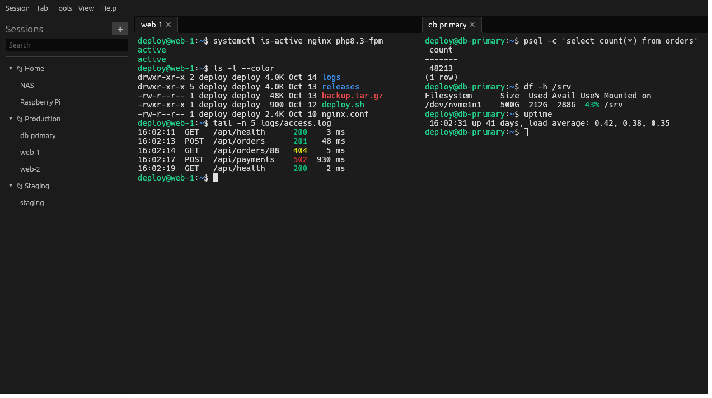
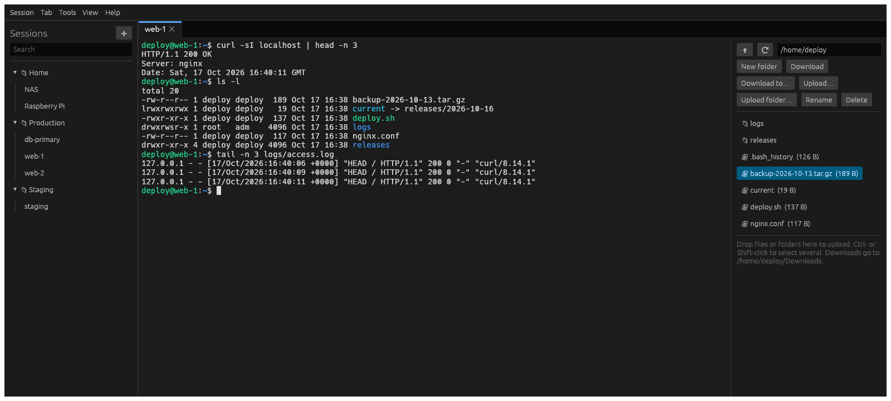
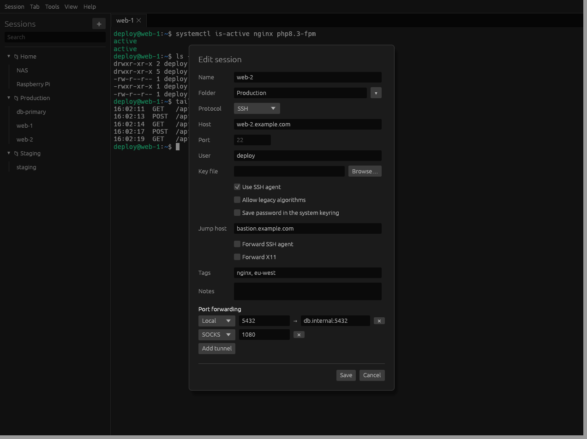
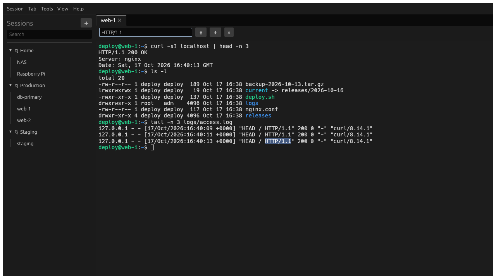
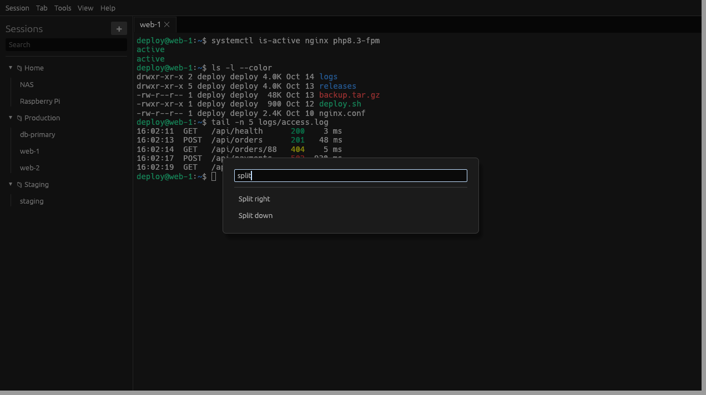
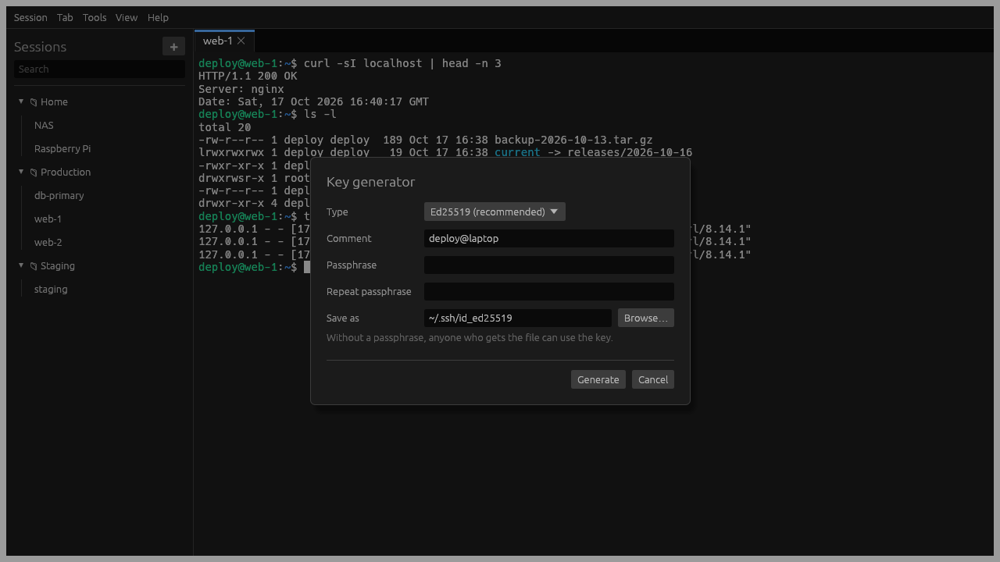
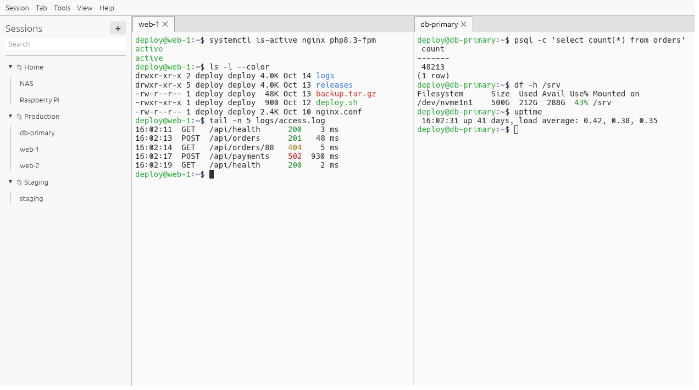

# Rooste SSH

A fast, memory-safe SSH client for Linux and Windows, written in Rust: tabs and split panes, a
session manager, an SFTP file panel, port forwarding, and built-in key tools and agent.

*Rooste* is Estonian for *rust*, the language it's written in.



## Features

- **Sessions:** tabs, split panes and a searchable session manager with folders and tags.
  Duplicate a tab, reconnect automatically when a connection drops, and type into several sessions
  at once (broadcast input). Every action is also in the command palette.
- **Logins:** SSH agent (OpenSSH's, Pageant on Windows, or the built-in one), key files in
  OpenSSH or `.ppk` format, passwords saved in the system keyring, and keyboard-interactive login
  with one-time codes. Unknown host keys are confirmed and saved to `~/.ssh/known_hosts`.
- **Forwarding:** local, remote and dynamic (SOCKS) port forwarding with saved tunnels, jump
  hosts (`ProxyJump`), and agent and X11 forwarding.
- **Files:** an SFTP panel next to the terminal. Browse, download or upload files and whole
  folders, drop files onto it to upload, or choose a folder with "Download to…".
- **Terminal:** true color, Unicode, mouse support, search through the scrollback, per-tab zoom
  and logging sessions to text files.
- **Tools:** generate keys, convert between `.ppk` and OpenSSH keys, and keep keys in a built-in
  SSH agent that other programs can use.
- **Also:** telnet, raw TCP and serial connections; light and dark themes; a portable mode; an
  opt-in per session for old devices that need outdated algorithms.
- **Works with what you have:** imports hosts from `~/.ssh/config` and saved sessions from PuTTY.

## Screenshots

<table>
  <tr>
    <td width="50%">
      
      <p><b>SFTP file panel</b>: browse the server, download or upload files and folders.</p>
    </td>
    <td width="50%">
      
      <p><b>Saved sessions</b>: jump hosts, tags and tunnels that start with the session.</p>
    </td>
  </tr>
  <tr>
    <td>
      
      <p><b>Search</b> through everything a session printed (Ctrl+Shift+F).</p>
    </td>
    <td>
      
      <p><b>Command palette</b>: every action a few keystrokes away (Ctrl+Shift+P).</p>
    </td>
  </tr>
  <tr>
    <td>
      
      <p><b>Key tools</b>: generate keys, convert <code>.ppk</code> keys, run a built-in agent.</p>
    </td>
    <td>
      
      <p><b>Light theme</b>, or dark, in Settings.</p>
    </td>
  </tr>
</table>

## Installing

Download a release from the [releases page](https://github.com/rooste-ssh/rooste-ssh/releases):

| Platform | Download | Notes |
|---|---|---|
| Windows | `rooste-ssh-*-x64.msi` | Installer, with Start menu entry |
| Windows (portable) | `rooste-ssh-*-windows-x64-portable.zip` | Unzip and run; settings stay in the folder |
| Debian, Ubuntu | `rooste-ssh-*-amd64.deb` | `sudo apt install ./rooste-ssh-*-amd64.deb` |
| Fedora, openSUSE | `rooste-ssh-*.x86_64.rpm` | `sudo dnf install ./rooste-ssh-*.x86_64.rpm` |
| Any Linux | `rooste-ssh.flatpak` | `flatpak install --user rooste-ssh.flatpak` |
| Any Linux | `rooste-ssh-*-x86_64.AppImage` | Make it executable and run it |
| Any Linux | `rooste-ssh-*-linux-x86_64.tar.gz` | Plain binaries |

Every release lists SHA-256 checksums in `SHA256SUMS`. Both programs are included: `rooste` (the
desktop app) and `rooste-cli` (command line).

## Using it

Start **Rooste SSH**, then either fill in the quick-connect form or add a session with **➕**.
Double-click a saved session to connect. Right-click a session or a tab for more actions.

| Shortcut | Action |
|---|---|
| Ctrl+Shift+T | Quick connect |
| Ctrl+Shift+P | Command palette |
| Ctrl+Shift+F | Find in the terminal output |
| Ctrl+Shift+W | Close the tab |
| Ctrl + / Ctrl − / Ctrl 0 | Zoom in, out, reset (Ctrl + mouse wheel works too) |
| Ctrl+Shift+C, Ctrl+Shift+V | Copy, paste (selecting text also copies it) |

### X11 forwarding

Turn on **Forward X11** in a session to show the server's graphical programs on your desktop.
Linux desktops work as they are. On Windows, run an X server such as VcXsrv or X410 first. The
server only ever receives a random cookie, never your display's real one.

### Command line

```sh
rooste-cli user@host                              # interactive shell
rooste-cli user@host ls                           # run a command
rooste-cli -J bastion -L 5432:db:5432 -N user@host   # jump host + port forward
```

`rooste-cli` tries the SSH agent, then `~/.ssh/id_ed25519`, `id_ecdsa` and `id_rsa` (or keys given
with `-i`), then answers the server's questions (a password, one-time codes). Run
`rooste-cli --help` for all options.

## Configuration

Settings and saved sessions are stored in `config.toml` in the platform config directory
(`~/.config/rooste-ssh/` on Linux, `%APPDATA%\rooste-ssh\` on Windows). To run portably,
for example from a USB stick, put an empty file named `portable` next to the executable; the
configuration is then kept in `rooste.toml` beside it. Saved passwords go to the system keyring,
never into the configuration file.

## Building from source

Requires Rust 1.95 or newer. On Linux the desktop app needs the usual X11 or Wayland libraries
(present on any desktop).

```sh
cargo build --release
cargo run -p rooste-gui              # desktop app (binary: rooste)
cargo run -p rooste-cli -- user@host
```

See [CONTRIBUTING.md](CONTRIBUTING.md) for running the tests and the repository layout, and
[docs/ROADMAP.md](docs/ROADMAP.md) for the design and what is planned.

## Code signing policy

Windows releases are to be signed with free code signing provided by
[SignPath.io](https://signpath.io), certificate by
[SignPath Foundation](https://signpath.org). Until that is in place, releases are unsigned; check
downloads against `SHA256SUMS`.

- Committers and reviewers: [members of the rooste-ssh organization](https://github.com/orgs/rooste-ssh/people)
- Approvers: Martin Vooremäe ([@matbcvo](https://github.com/matbcvo))

Only binaries built from this repository by its GitHub Actions release workflow are signed, and
every release is approved by hand.

## Privacy

Rooste SSH collects no data and has no telemetry. It connects only to the servers you open
sessions to, and, if "Check for updates at startup" is on (Settings), asks GitHub's API
(`api.github.com`) once per start whether a newer release exists. That request sends nothing but
the usual HTTP headers, including the app version in the user agent. Saved sessions, settings and
session logs stay on your computer; saved passwords are kept in the system keyring.

## Security

Please report vulnerabilities privately, as described in [SECURITY.md](SECURITY.md).

## License

[MIT](LICENSE)
